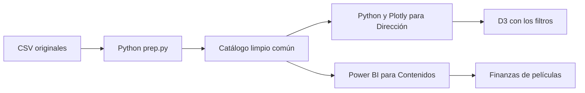

# Arquitectura por audiencia

Python y Power BI comparten criterios de clave única, categorías y muestra financiera. Un clic en Python no filtra automáticamente Power BI: son productos separados para audiencias distintas.

Python lee el catálogo común. El PBIX contiene una instantánea incorporada; para obtener nuevos registros hay que cambiar o reemplazar el origen y guardar otra versión. D3 sí recibe el catálogo filtrado desde Python.
